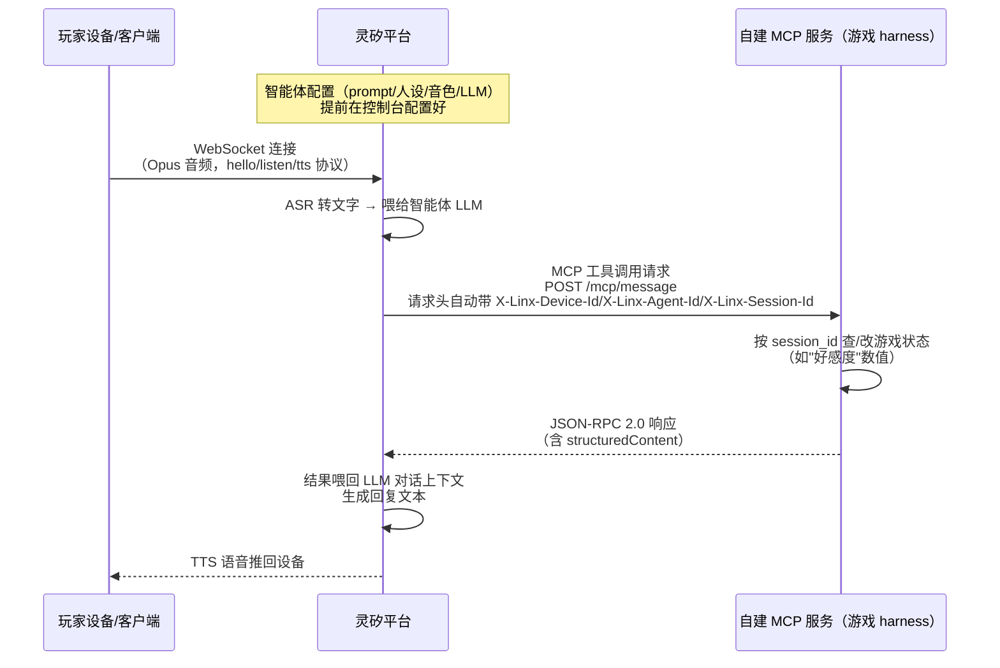

# 技术预研究文档：灵矽平台

> 上级文档：[project-overview.md](./project-overview.md)。本文件记录灵矽（Lingxi/Xrobot）平台的能力边界、
> 客户端选型调研，以及已经实测验证过的免硬件开发方案，供设计具体游戏架构时参考。

## 平台简介

灵矽（Xrobot）是七牛云的语音 AI 交互平台，设备端通过 WebSocket 连云端做语音交互，设备形态走开源小智
（xiaozhi-esp32）路线的硬件集成思路。

- 官网：https://linx.qiniu.com/
- 开发者文档：https://linx.qiniu.com/docs/
- 控制台：https://linx.qiniu.com/（点"立即体验" → 用七牛账号登录）

## 应用与平台交互架构（关键：游戏 harness 不在灵矽平台上）



**结论**：灵矽平台只提供设备语音通道（ASR/TTS/WebSocket）、智能体对话层、MCP 网关三件事，**不托管我们
的业务代码**。游戏规则引擎、状态机（比如"套话风暴"的好感度计算）必须自己写一个服务（哪怕是个简单的
serverless 函数）挂出去，走 MCP 协议接入。类比 Alexa 和 Alexa Skill 的关系——灵矽是"语音处理+对话调度"，
自建的 MCP 服务才是"技能后端"。

**关键细节**：灵矽平台会在发给 MCP 服务的请求头里**自动带上 `X-Linx-Device-Id`/`X-Linx-Agent-Id`/`X-Linx-Session-Id`**
（但不会自动塞进工具入参里）。这对需要按局/按玩家维护状态的游戏很关键——MCP 服务直接拿请求头里的
会话标识查/改当前会话状态；玩家、房间及断线重连映射仍需业务层维护（来源：`mcp/software-mcp`）。

## 平台能力调研结论

调研范围：文档站下设备接入协议、API、MCP 接入、最佳实践、计费等约 20 个子页面。

1. **多人/房间能力——平台没有原生支持，需自建（文档推断 + 实测双重确认）**：
   - 文档推断：WebSocket 协议是"单设备-单会话"模型，靠 `session_id` 做会话隔离（设计目的是防互相
     干扰，跟"多方互相可听见"反方向）。某议题提到的"语音切换群（房间）"是要求开发者自己实现的产品
     需求，不是灵矽现成能力（来源：`platform/websocket`、`api/device`、`guide/third-app`）。
   - **实测确认**（2026-10-23）：给同一个智能体手动添加两个虚拟设备（MAC `AA:BB:CC:00:11:22` /
     `AA:BB:CC:00:11:23`），用 Python（`websockets` 库）直接按协议分别建立两条 WebSocket 连接，
     各自完成 `hello` 握手后各拿到独立 `session_id`。在设备 A 的连接上发送"开始说话"
     （`listen/start`）指令和一帧模拟二进制音频数据，持续监听设备 B 的连接 8 秒，**B 全程未收到
     任何与 A 相关的消息**——证实平台不会在共享同一智能体的设备间转发任何会话内容，哪怕只是触发
     信号也不会跨会话传播。
   - **主动播报已实测可行**：自建后端持有各玩家的上游 WS，在目标连接发送 `listen.detect + text_response`，
     可在没有玩家语音输入时触发指定文字 TTS。MCP 的 `structuredContent` 没有已验证的跨会话推送能力，
     不能仅凭会话 ID 就假定能路由到其他设备。详见后文实测记录。
2. **ASR/TTS**：支持全双工+打断（barge-in）、流式识别、Opus 编解码、16/24kHz 采样。延迟数值、识别
   准确率文档未给。Python 合成语音回放已跑通完整链路，上传结束至回答首音频约 1.85～2.31 秒；
   真人语音准确率、浏览器采集播放及尾延迟仍需测（来源：`platform/websocket`，后文实测记录）。
3. **智能体/MCP**：Prompt/人设高度可配置（角色介绍最多 6000 字），但**平台没有原生流程编排/状态机
   能力**。复杂游戏阶段流转（比如夜晚→白天→投票→结算）建议放自己的云端 MCP 服务里做，智能体只负责
   对话表现层。MCP 接入确认不需要在灵矽平台侧填敏感信息，密钥由自己的云端服务管理
   （来源：`guide/agent-config`、`mcp/software-mcp`）。知识库/长期记忆更偏"记用户偏好"，不是为"记
   游戏局内状态"设计的。
4. **声纹识别**：有现成 API（创建说话人→绑定智能体→识别/仅回应指定说话人），但多人同时说话时能否
   做说话人分离，文档未说明（来源：`api/voiceprint-v2`）。
5. **计费与并发限制**：按时长计费，扣减倍率 1.0~2.0 倍区间；**并发连接数/房间数限制文档完全未提**，
   已验证 2 个不同设备同时在线，未见握手限流；两路正常 AI 业务并发和更高并发上限尚未验证。
   A 业务请求报额度不足、B 正常，需排查（来源：`billing/resource-usage-billing`，后文实测记录）。

**一句话总结**：需要私密频道／多会话互动的方向已有“自建后端控制独立 WS、主动指定播报”的可行路径，
当前瓶颈是两路正常业务及更高并发未验证、A 的额度异常，以及完整 AI 回答约两秒的等待；单会话的
“人类暗号”核心模式不依赖跨会话路由，但仍需完成客户端与体验验证。

## 客户端选型

灵矽提供两种官方客户端参考方案，调研后结论如下：

### 方案对比

| | 灵矽 AI 小程序+后台方案（`guide/platform-mp`） | C++ client-demo（`guide/client-demo`） |
|---|---|---|
| 本质 | 面向终端用户的完整产品（账号体系+设备管理+智能体配置+语音复刻+管理后台） | 开发者工具，模拟"设备端"本身的协议客户端 |
| 核心流程 | "蓝牙配网绑定真实硬件设备" | 直接用 WebSocket 协议连云端，无需硬件 |
| 适合我们？ | **不适合**——对没有硬件的团队风险较大，文档未说明能否脱离硬件独立完成语音对话 | **适合**，但仓库代码本身有质量问题（见下） |

**结论：放弃小程序方案，改用 client-demo + MAC 预注册的免硬件路径**（已实测验证，见下）。

### 免硬件开发方案：已验证可行

拼合文档信息 + 实测验证的完整结论：

1. **原理**：`api/device` 文档提到"MAC地址批量导入（预注册）"，只需 `agent_id` + `mac_addresses` 即可
   批量预注册设备，不要求对应真实硬件；`guide/client-demo` 连接/注册请求携带的字段正是 `mac_address`、
   `chip_model_name`、`flash_size`，与批量导入所需字段吻合。
2. **控制台实测**（2026-10-23，已确认）：
   - 登录灵矽控制台（linx.qiniu.com → 立即体验 → 七牛账号登录）
   - 智能体管理 → 新建智能体（示例：语言模型 `deepseek-v4-flash`，默认音色"调皮公主"）
   - 设备管理 → **"手动添加"只需要填一个 MAC 地址字符串，没有蓝牙配对、没有硬件校验**
   - 用虚构 MAC `AA:BB:CC:00:11:22` 直接添加成功，设备列表立刻出现绑定记录
   - 还有"批量预先导入"按钮，可一次注册多个 MAC（适合多人游戏，每个玩家一个虚拟设备）
3. **C++ demo 的 OTA 实测**（2026-10-23，已确认）：
   - 克隆 https://github.com/sunqirui1987/linx-linux
   - 在 `demo/linx.cc` 里把 `device_mac`/`device_uuid` 常量改成控制台预注册的 MAC
     （`AA:BB:CC:00:11:22`）
   - 安装依赖：`build-essential cmake pkg-config libasound2-dev libopus-dev libcurl4-openssl-dev
     libssl-dev libwebsockets-dev`（**注意：实际用的是 libwebsockets 库，不是文档暗示的
     websocketpp**，包名以此为准）
   - `cmake -DBUILD_SHARED_LIBS=OFF -DCMAKE_POSITION_INDEPENDENT_CODE=ON -DCMAKE_BUILD_TYPE=Debug
     -DCMAKE_INSTALL_PREFIX=./install .. && make -j4 && make install`
   - 运行后，**OTA 握手连续 3 次成功**：程序以预注册 MAC 发起 OTA 请求，服务器正确识别该 MAC 并
     返回签名的 WebSocket 会话 JWT token
   - **结论：免硬件接入路径在服务器端已确认真实可用**，可以放心按这个方式规划多人虚拟设备

### client-demo 仓库本身的问题（与灵矽平台无关，是这份开源代码的质量问题）

实测中额外发现两个 bug，供后续直接使用/参考这份代码时避坑：

1. `audio->Record()` / `audio->Play()`（`linxsdk/alsaaudio/include/AlsaAudio.h`）**不是初始化音频流**，
   而是一个阻塞式的"按空格录音、松开回放"本地自测函数。在没有真实终端按键的环境（CI、服务器、自动化
   脚本、容器沙箱）里会永久卡死在等待按键的循环里。
2. 跳过上述自测逻辑、让程序进入正常的多线程语音管道后，在 `linxsdk/websocket/src/Websocket.cc` 的
   WebSocket 握手阶段（`LWS_CALLBACK_CLIENT_APPEND_HANDSHAKE_HEADER`，约第 201 行）写入自定义请求头
   时会触发崩溃。gdb 定位为 spdlog 全局日志对象被多线程并发访问破坏（线程安全 bug），不是灵矽平台或
   认证逻辑的问题。完整语音往返未能在沙箱环境里跑通到底，但这不影响已经验证成功的"OTA 认证"这个关键
   结论。

**建议**：把 client-demo 当作**协议参考**，不要直接把这份代码当生产客户端用。协议要点：

- WebSocket 地址：`ws://xrobo-io.qiniuapi.com/v1/ws/`；官方也支持 `wss://xrobo-io.qiniuapi.com/v1/ws/`
- OTA 地址：`https://xrobo.qiniuapi.com/v1/ota/`
- 请求头：`Authorization: Bearer <token>`、`Device-Id: <mac>`、`Client-Id: <uuid>`、
  `Protocol-Version: 1`
- 消息格式：`hello` / `listen`（`start`/`stop`/`detect`）/ `tts`（`state`）等 JSON 文本帧；
  `listen` 支持 `manual`/`auto`/`realtime` 模式，`detect + text_response` 可触发指定文字播报；
  音频数据走二进制帧，Opus 编码，16kHz 单声道
- 音频参数：采样率 16000Hz，帧大小建议 320 samples（20ms）或 960（60ms，demo 默认值）

### 给玩家用的客户端建议

不依赖小程序，也不直接复用 client-demo 代码，建议自己写一个网页端：浏览器 Web Audio API 采集麦克风，
按上面协议要点接入，配合 MAC 预注册。单会话可以由客户端持有上游连接；若需要私密通知，优先考虑由
自建后端持有各玩家的灵矽 WS，再转发音频与控制事件。若浏览器直接持有上游连接，后端需另建控制通道
通知浏览器发送指定播报指令，不能假设 MCP 能注入任意目标会话。浏览器直连还需验证自定义认证头的
兼容方案（标准浏览器 WebSocket API 无法像 Python 一样设置这些头）。好处：

- 不需要任何硬件
- 比编译 C++ 命令行程序对真人玩家更友好，可以直接做成游戏 UI
- 规避了 client-demo 仓库本身的 bug

## 待办 / 仍需验证的点

- [x] 两个预注册 MAC 同时在线及独立 hello 会话
- [x] 已有会话无玩家音频输入时触发指定文字 TTS，并确认另一会话收不到内容
- [x] Python 完整 ASR→LLM→TTS 往返（合成语音回放样本）
- [x] 未注册 MAC 的 OTA 行为：返回激活码，不返回 WS token
- [ ] 排查 A 的 `10005` 额度错误，复测两路正常 AI 业务同时运行
- [ ] 5 / 10 并发与平台上限：分别需要用户帮忙预注册 3 / 8 个额外 MAC
- [ ] 真人语音准确率、多轮延迟分布、长时连接与重连、打断及播报队列冲突
- [ ] 声纹识别是否支持多人同时说话的说话人分离
- [ ] 自建网页客户端完整语音往返及实际播放延迟（Python 跑通不等于浏览器跑通）

## 2026-10-23 会话、并发与主动播报实测

### 范围与方法

游戏方向尚未锁定；本测试用于判断“需要私密频道／多会话互动”的方向是否具备底层能力，不绑定某个游戏。
设备 A 为 `AA:BB:CC:00:11:22`，B 为 `AA:BB:CC:00:11:23`，均为已预注册、绑定测试智能体的虚拟设备。
测试使用 Python `requests`、`websockets 17.3`、`time.perf_counter()`；脚本位于临时目录，未纳入仓库。
下列数据均为测试主机的应用层观测，不含浏览器麦克风和播放器缓冲。

协议来源：

- [官方 OTA 协议](https://linx.qiniu.com/docs/xrobot/platform/OTA.html)
- [官方 WebSocket 协议](https://linx.qiniu.com/docs/xrobot/platform/websocket.html)
- [官方云端 MCP 接入](https://linx.qiniu.com/docs/xrobot/mcp/software-mcp.html)

OTA 为 `POST https://xrobo.qiniuapi.com/v1/ota/`，请求头如下；每次生成 UUID v4，且请求体 MAC 与头一致：

```text
Activation-Version: 1
Device-Id: <MAC>
Client-Id: <UUID v4>
User-Agent: xiaoling-web-test/1.0.0
Content-Type: application/json
```

主测脚本使用的 OTA 请求体形状（MAC、UUID 为占位符；固件元数据为测试值）：

```json
{
  "version": 0,
  "uuid": "<UUID v4>",
  "application": {"name": "test", "version": "1", "elf_sha256": "x"},
  "board": {"type": "test", "ssid": "x", "rssi": 0, "mac": "<MAC>"},
  "mac_address": "<MAC>"
}
```

首次 OTA 检查还按官方完整示例提供了 `ota`、`flash_size`、`chip_info`、`partition_table` 等字段；两种
请求形状均可取得已绑定设备 token。返回 token 为认证凭证，此处不复制其值。

WS 使用 OTA 返回的 `ws://xrobo-io.qiniuapi.com/v1/ws/`，带
`Authorization: Bearer <token>`、`Device-Id`、`Client-Id`、`Protocol-Version: 1`。
发送 hello 后，等待返回 `type: hello` 才进入业务测试：

```json
{
  "type": "hello",
  "version": 1,
  "transport": "websocket",
  "audio_params": {
    "format": "opus", "sample_rate": 16000, "channels": 1, "frame_duration": 60
  }
}
```

### 基础握手与并发连接

“连接建立”从调用 connect 到 WS upgrade 完成；“hello 往返”从发出 hello 到收到 ack；总计不含 OTA。

| 单连接 A | 连接建立 | hello 往返 | 握手总计 |
|---|---:|---:|---:|
| 1 | 115.0 ms | 44.6 ms | 159.8 ms |
| 2 | 94.4 ms | 45.2 ms | 139.8 ms |
| 3 | 87.9 ms | 42.2 ms | 130.2 ms |

首次 OTA：A 为 206.0 ms，B 为 199.7 ms，均 HTTP 200 且返回 token。把独立测量相加，包含 OTA 的冷启动
约 0.33～0.37 秒；这是估计，游戏中宜保持长连接。WSS 另测两次串行握手，连接建立为 194.2 / 187.9 ms，
hello 为 41.1 / 44.9 ms，总计约 235 / 233 ms。

一条完整 hello ack 原文：

```json
{"type":"hello","version":1,"transport":"websocket","session_id":"bUEiAApY8HeAXgYA","audio_params":{"format":"opus","sample_rate":16000,"channels":1,"frame_duration":60,"bits_per_sample":16,"play_buffer_duration":600}}
```

双连接测试先分别完成 OTA，再用 `asyncio.gather` 同时 connect，避免串行 OTA 影响连接计时：

| 轮次 | A 连接建立 / hello | B 连接建立 / hello | A / B OTA（单独计时） |
|---|---:|---:|---:|
| 1 | 114.2 / 43.8 ms | 91.1 / 43.6 ms | 206.9 / 211.7 ms |
| 2 | 91.2 / 43.5 ms | 86.3 / 41.5 ms | 198.6 / 211.6 ms |
| 3 | 91.0 / 43.5 ms | 84.9 / 40.6 ms | 207.2 / 213.3 ms |

全部成功，各连接返回独立 session_id，没有看到 HTTP 429、连接拒绝或并发上限提示，hello 延迟与单连接
基本一致。另一次双连接握手总计为 A 133.7 ms、B 126.5 ms。

**限制：A 的业务请求持续报额度不足，而 B 正常。** 同时触发业务时，A 在 43.4 ms 返回下面的错误，
437.7 ms 返回错误提示的首音频；B 在 41.3 ms 返回指定文字，411.4 ms 返回正常首音频。

```json
{"type":"stt","session_id":"2WsYAKZU0HiAXgYA","text":"额度不足，请联系灵矽商务","error_code":10005}
```

A 三次单连接业务测试同样返回 `10005`，首错误事件分别为 44.9 / 45.6 / 42.5 ms，错误播报首音频为
579.7 / 796.4 / 343.1 ms，TTS stop 为 3999.8 / 4456.3 / 3763.3 ms。这些是错误处理路径，不能作为
正常 AI 对话延迟。错误不只发生在并发场景，不能认定为并发限流；A、B 表现差异的具体原因尚不明确。

结论只覆盖“两连接同时在线”，尚未覆盖“两路正常 AI 业务同时运行”，更不能据此推出 5 / 10 并发容量。
5 并发需要用户帮忙预注册 3 个额外 MAC，10 并发需要额外 8 个；未尝试登录控制台。

### 已有会话内主动指定播报与隔离

官方协议支持如下消息；测试程序保持连接，等待定时器后发送，没有玩家语音输入：

```json
{
  "type": "listen", "state": "detect",
  "text": "定时提醒触发", "text_response": "请只回答数字一"
}
```

B 正常返回指定文字和 Opus 音频。下表时间全部相对发出上述指令：

| 条件 / 次数 | 首文本事件 | TTS start | 首音频 | TTS stop | 音频帧数 / bytes |
|---|---:|---:|---:|---:|---:|
| B 单连接 1 | 43.9 ms | 344.6 ms | 375.7 ms | 2356.3 ms | 33 / 3227 |
| B 单连接 2 | 43.9 ms | 447.9 ms | 478.7 ms | 2699.0 ms | 37 / 3734 |
| B 单连接 3 | 43.8 ms | 344.1 ms | 375.4 ms | 2415.0 ms | 34 / 3239 |
| A 在线、B 播报 1 | 47.2 ms | 360.8 ms | 391.9 ms | 2194.8 ms | 30 / 3053 |
| A 在线、B 播报 2 | 47.2 ms | 378.1 ms | 409.0 ms | 2388.6 ms | 33 / 3351 |
| A 在线、B 播报 3 | 47.2 ms | 348.5 ms | 379.4 ms | 2359.6 ms | 33 / 3362 |

双连接第 1 次的关键响应原文（省略其中的 llm 表情事件，二进制帧用上表统计）：

```json
{"type":"stt","session_id":"v54PALxrOHuAXgYA","text":"请只回答数字一"}
{"type":"tts","session_id":"v54PALxrOHuAXgYA","state":"start"}
{"type":"tts","session_id":"v54PALxrOHuAXgYA","state":"sentence_start","text":"请只回答数字一"}
{"type":"tts","session_id":"v54PALxrOHuAXgYA","state":"stop","is_aborted":false}
```

A 从 hello 后持续监听，直到 B 完成三次播报和后续一轮音频对话，结果为 `A_IDLE_RECEIVED []`。
因此本样本同时验证：可以无玩家发言触发已有会话的指定播报，且不会自动泄漏到另一个设备连接。
单连接播报首音频为 375～479 ms，另一连接在线时为 379～409 ms，未看到明显变差；样本不足以代表尾延迟。

**架构含义**：后端若持有各玩家的上游 WS，就可维护玩家→连接映射，在目标连接发送上述指令，再把返回
音频送给对应玩家；这需要自建音频代理、播放队列和打断控制。若浏览器直连平台，则后端需要自建控制通道
让浏览器发送该指令。这里验证的是从目标连接发起指定播报，**没有验证另一个服务仅凭 session_id 就能
注入玩家已经持有的连接**，也尚未验证任意多人音频转发、多人混音或完整游戏后端。

### 完整音频识别→LLM→TTS

先通过上述播报得到“请只回答数字一”的真实 Opus 帧，保留帧边界，再向 B 发送：

1. `{"type":"listen","state":"start","mode":"manual"}`。
2. 按每帧 60 ms 的节奏发送所保留的 Opus 二进制帧。
3. `{"type":"listen","state":"stop"}`，持续接收到 TTS stop。

| 指标 | 只有 B 在线 | A 在线空闲、B 对话 |
|---|---:|---:|
| 音频上传结束，距开始 | 2048.2 ms | 1987.6 ms |
| 收到 ASR，距开始 | 2681.3 ms | 2376.9 ms |
| TTS start，距开始 | 3865.6 ms | 4265.6 ms |
| 首个回答音频，距开始 | 3896.6 ms | 4296.4 ms |
| 最后一个回答音频，距开始 | 4488.2 ms | 4887.6 ms |
| TTS stop，距开始 | 4916.9 ms | 5316.5 ms |
| 上传结束→首音频 | **1848.4 ms** | **2308.8 ms** |
| 上传结束→TTS stop | 2868.7 ms | 3328.9 ms |
| 回答音频帧数 / bytes | 17 / 1350 | 17 / 1387 |

单连接的关键响应（省略 session_id）：

```json
{"type":"stt","text":"请只回答数字一。"}
{"type":"tts","state":"sentence_start","text":"1"}
```

双连接时 ASR 同样正确，答案为“一”。此处确实经过了音频识别并生成不同于输入的回答，不是简单回放
`text_response`。每种条件只有一轮，不能把约 460 ms 的差异归因于并发。样本为合成清晰语音，不覆盖
真人口音、环境噪声、浏览器音频处理或设备播放；但约两秒的回答等待已提示紧凑节奏游戏需设计留白。

### 2026-10-24：开放监听与按停顿分段

为验证《别让它听见》的“AI 持续旁听”是否可行，新增仓库内
`src/game_backend/tools/realtime_probe.py`。它复用后端的 `Pcm16OpusEncoder`，以真实 60ms 节奏直连
灵矽，在发出 `listen/start` 后持续接收事件，刻意延后 `listen/stop`；此前直连测试无事件是因错误把
裸 PCM16 当作 Opus 发送，不能作为平台行为结论。

单句“查询游戏状态。”（2.04 秒合成语音，音频结束后额外保持 3 秒开放）三种模式均在 `stop` **之前**
返回一条正确的 `stt`：

| mode | 收到 `stt`（距起始） | 音频结束后 | `stop` 前有 ASR |
|---|---:|---:|---|
| `realtime` | 2772.6 ms | 732.6 ms | 是 |
| `auto` | 2824.0 ms | 784.0 ms | 是 |
| `manual` | 3853.9 ms | 1813.9 ms | 是 |

因此“必须发 stop 才会识别”的假设被推翻；但这三次收到的都是**一句结束后的最终 `stt`**，不是逐词/中间
识别结果。禁语可在玩家完成一小段话后的约 0.6～1.8 秒内结算，不能承诺在词刚出口时抢断。

在一个 `realtime` 会话内连续发送“查询游戏状态。”、1.2 秒静音、“拿起钥匙。”，全程未发 `stop`，分别于
2804.3 ms、5677.8 ms 收到两条正确 `stt`。这确认服务端会按自然停顿切分多个语段，开放会话可以作为
房间的持续 ASR 输入。第二条识别后，平台又在 7383.8 ms 自行发出 `tts/start`，说明 `stop` 不是 AI
回复的唯一触发条件，不能把它当作游戏回合边界。

另做 barge-in 样本：第一句识别后等待平台开始 TTS（7579.6 ms），随即持续发送“拿起钥匙。”；在
8571.7 ms 收到 `{"type":"tts","state":"stop","is_aborted":true}`，第二句又在 9530.4 ms 被正确
识别。这确认新语音会中断播报，且同一开放会话仍能继续 ASR。

**架构结论**：游戏开始时每名玩家保持一个 `realtime` 上游会话；后端在收到每条 `stt` 时立即调用自己的
确定性状态机做标准化、动态禁语匹配、警报/连锁后果结算和 WebSocket 广播。不要等 LLM/MCP 工具调用或
TTS 完成。`realtime` 选择依据是其文档定义的全双工/打断语义，而不是“只有它能在 stop 前识别”（这次样本
不支持后一个说法）。真人口音、噪声和长连接仍未覆盖。

### MCP 能否跨会话主动推送

此项为官方文档核对，**未配置控制台 MCP 服务进行端到端实测**。

`software-mcp` 描述的流程是平台经 `GET /mcp` SSE、`POST /mcp/message` 发现和调用工具；请求头自动带
`X-Linx-Device-Id`、`X-Linx-Agent-Id`、`X-Linx-Session-Id`，不自动写入工具 arguments。

工具结果可返回 `structuredContent`，结构例如：

```json
{
  "jsonrpc": "2.0", "id": 5,
  "result": {
    "content": [{"type": "text", "text": "播放音频"}],
    "structuredContent": {
      "code": 0,
      "funcs": [{"name": "linx_play", "arguments": {"audio_url": "https://example.com/audio.mp3", "title": "通知"}}],
      "message": ""
    },
    "isError": false
  }
}
```

文档列出的系统函数为 `linx_play`、`linx_stop`、`change_role`。它们是当前工具调用的响应，没有文档化的
目标会话路由字段或任意文字 TTS 函数；也未找到按目标 session_id 主动推送的公开 HTTP API。
SSE 的存在本身不能证明平台支持跨会话通知的业务语义。因此不能把 A 的工具结果自动送给空闲 B 作为
架构前提。已有实测可用的路线是控制目标 WS，发送 `listen.detect + text_response`。

### 未注册 MAC 的 OTA 行为

随机新 MAC `AA:BB:CC:99:88:77` 按官方完整示例发送 OTA，请求耗时 223.5 ms，HTTP 200；响应原文：

```json
{"server_time":{"timestamp":1792755281032,"timezone":"Asia/Shanghai","timezone_offset":480},"activation":{"code":"594022","message":"https://xrobo.qiniu.com\n594022","challenge":"AA:BB:CC:99:88:77"},"firmware":{"version":"1.0.0","url":"https://xrobo.qiniuapi.com/v1/ota/INVALID_FIRMWARE_FOR_TEST"},"websocket":{"url":"ws://xrobo-io.qiniuapi.com/v1/ws/"}}
```

**未注册设备可以请求 OTA，但只拿到激活码和 WS 地址，没有 token。** 官方 WS 协议要求先注册或绑定智能体；
本次未另测无 token 的 WS 握手。HTTP 200 不能当成可直接对话的证据，当前虚拟设备方案仍需预注册，
或改走激活码绑定流程，不能直接省掉绑定步骤。
