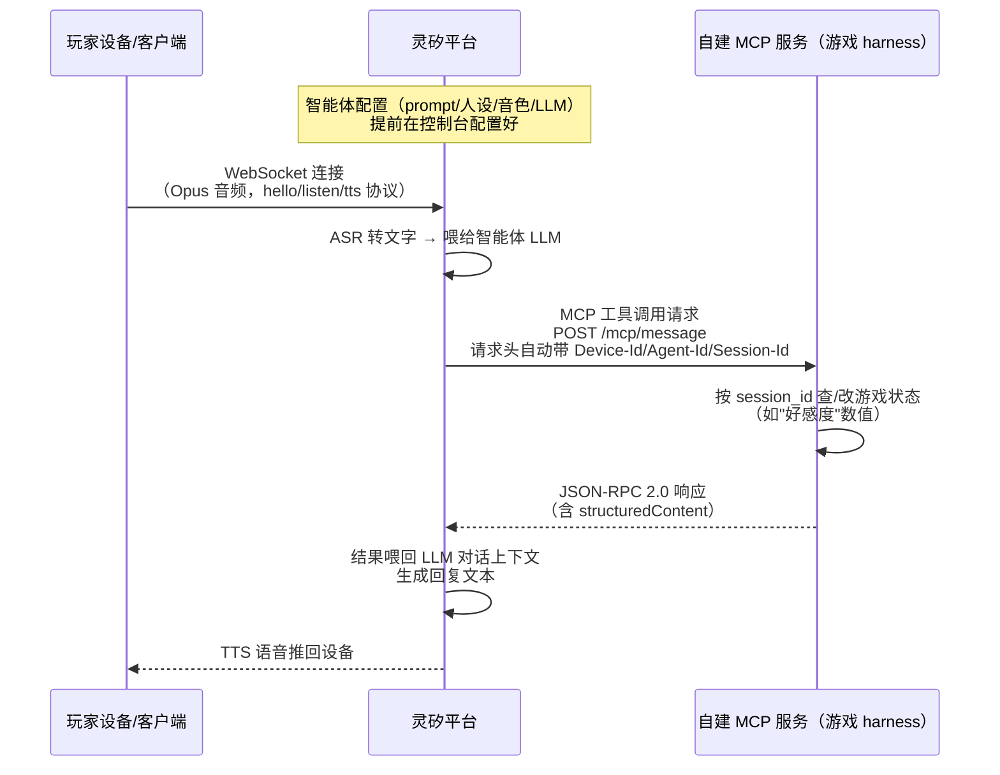

# 技术预研究文档：灵矽平台

> 上级文档：[project-overview.md](./project-overview.md)。本文件记录灵矽（Lingxi/Xrobot）平台的能力边界、
> 客户端选型调研，以及已经实测验证过的免硬件开发方案，供设计具体游戏架构时参考。

## 平台简介

灵矽（Xrobot）是七牛云的语音 AI 交互平台，设备端通过 WebSocket 连云端做语音交互，设备形态走开源小智
（xiaozhi-esp32）路线的硬件集成思路。

- 官网：https://linx.qiniu.com/
- 开发者文档：https://linx.qiniu.com/docs/
- 控制台：https://linx.qiniu.com/（点"立即体验" → 用七牛账号登录）

## 应用与平台交互架构（关键：游戏 harness 不在灵矽平台上）

**结论**：灵矽平台只提供设备语音通道（ASR/TTS/WebSocket）、智能体对话层、MCP 网关三件事，**不托管我们
的业务代码**。游戏规则引擎、状态机（比如"套话风暴"的好感度计算）必须自己写一个服务（哪怕是个简单的
serverless 函数）挂出去，走 MCP 协议接入。类比 Alexa 和 Alexa Skill 的关系——灵矽是"语音处理+对话调度"，
自建的 MCP 服务才是"技能后端"。

**关键细节**：灵矽平台会在发给 MCP 服务的请求头里**自动带上 `Device-Id`/`Agent-Id`/`Session-Id`**
（但不会自动塞进工具入参里）。这对需要按局/按玩家维护状态的游戏很关键——MCP 服务直接拿请求头里的
`session_id` 当 key 去查/改状态即可，不需要自己再设计一套会话识别机制（来源：`mcp/software-mcp`）。

## 平台能力调研结论

调研范围：文档站下设备接入协议、API、MCP 接入、最佳实践、计费等约 20 个子页面。

1. **多人/房间能力——平台没有原生支持，需自建（文档推断 + 实测双重确认）**：
   - 文档推断：WebSocket 协议是"单设备-单会话"模型，靠 `session_id` 做会话隔离（设计目的是防互相
     干扰，跟"多方互相可听见"反方向）。某议题提到的"语音切换群（房间）"是要求开发者自己实现的产品
     需求，不是灵矽现成能力（来源：`platform/websocket`、`api/device`、`guide/third-app`）。
   - **实测确认**（2026-10-23）：给同一个智能体手动添加两个虚拟设备（MAC `AA:BB:CC:00:11:22` /
     `AA:BB:CC:00:11:23`），用 Python（`websockets` 库）直接按协议分别建立两条 WebSocket 连接，
     各自完成 `hello` 握手后各拿到独立 `session_id`。在设备 A 的连接上发送"开始说话"
     （`listen/start`）指令和一帧模拟二进制音频数据，持续监听设备 B 的连接 8 秒，**B 全程未收到
     任何与 A 相关的消息**——证实平台不会在共享同一智能体的设备间转发任何会话内容，哪怕只是触发
     信号也不会跨会话传播。
   - **重要澄清：这不等于"平台上做不了多人游戏"**，只说明没有平台内置的广播原语。多人游戏如需要
     "子频道隔离"（比如只让部分玩家互相听见），完全可以自己在业务服务层（见上面"应用与平台交互
     架构"一节的自建 MCP 服务）做转发/路由，工程量变大，但不是技术上做不到。
2. **ASR/TTS**：支持全双工+打断（barge-in）、流式识别、Opus 编解码、16/24kHz 采样。延迟数值、识别
   准确率文档未给，需实测（来源：`platform/websocket`）。
3. **智能体/MCP**：Prompt/人设高度可配置（角色介绍最多 6000 字），但**平台没有原生流程编排/状态机
   能力**。复杂游戏阶段流转（比如夜晚→白天→投票→结算）建议放自己的云端 MCP 服务里做，智能体只负责
   对话表现层。MCP 接入确认不需要在灵矽平台侧填敏感信息，密钥由自己的云端服务管理
   （来源：`guide/agent-config`、`mcp/software-mcp`）。知识库/长期记忆更偏"记用户偏好"，不是为"记
   游戏局内状态"设计的。
4. **声纹识别**：有现成 API（创建说话人→绑定智能体→识别/仅回应指定说话人），但多人同时说话时能否
   做说话人分离，文档未说明（来源：`api/voiceprint-v2`）。
5. **计费与并发限制**：按时长计费，扣减倍率 1.0~2.0 倍区间；**并发连接数/房间数限制文档完全未提**，
   直接影响多人游戏能同时支持几个玩家在线，需实测或找平台方确认（来源：`billing/resource-usage-billing`）。

**一句话总结**：核心挑战不在语音识别/合成（灵矽强项），而在"多人互相可听见/分组隔离"平台完全没有现成
支持——必须自建一层会话路由把灵矽当成"每个玩家一条独立语音通道"的底层能力提供方，房间逻辑、角色分组、
状态机全部自己做。**这也是选择最终游戏方向时的重要约束条件**（见 product-research.md）。

## 客户端选型

灵矽提供两种官方客户端参考方案，调研后结论如下：

### 方案对比

| | 灵矽 AI 小程序+后台方案（`guide/platform-mp`） | C++ client-demo（`guide/client-demo`） |
|---|---|---|
| 本质 | 面向终端用户的完整产品（账号体系+设备管理+智能体配置+语音复刻+管理后台） | 开发者工具，模拟"设备端"本身的协议客户端 |
| 核心流程 | "蓝牙配网绑定真实硬件设备" | 直接用 WebSocket 协议连云端，无需硬件 |
| 适合我们？ | **不适合**——对没有硬件的团队风险较大，文档未说明能否脱离硬件独立完成语音对话 | **适合**，但仓库代码本身有质量问题（见下） |

**结论：放弃小程序方案，改用 client-demo + MAC 预注册的免硬件路径**（已实测验证，见下）。

### 免硬件开发方案：已验证可行

拼合文档信息 + 实测验证的完整结论：

1. **原理**：`api/device` 文档提到"MAC地址批量导入（预注册）"，只需 `agent_id` + `mac_addresses` 即可
   批量预注册设备，不要求对应真实硬件；`guide/client-demo` 连接/注册请求携带的字段正是 `mac_address`、
   `chip_model_name`、`flash_size`，与批量导入所需字段吻合。
2. **控制台实测**（2026-10-23，已确认）：
   - 登录灵矽控制台（linx.qiniu.com → 立即体验 → 七牛账号登录）
   - 智能体管理 → 新建智能体（示例：语言模型 `deepseek-v4-flash`，默认音色"调皮公主"）
   - 设备管理 → **"手动添加"只需要填一个 MAC 地址字符串，没有蓝牙配对、没有硬件校验**
   - 用虚构 MAC `AA:BB:CC:00:11:22` 直接添加成功，设备列表立刻出现绑定记录
   - 还有"批量预先导入"按钮，可一次注册多个 MAC（适合多人游戏，每个玩家一个虚拟设备）
3. **端到端实测**（2026-10-23，已确认）：
   - 克隆 https://github.com/sunqirui1987/linx-linux
   - 在 `demo/linx.cc` 里把 `device_mac`/`device_uuid` 常量改成控制台预注册的 MAC
     （`AA:BB:CC:00:11:22`）
   - 安装依赖：`build-essential cmake pkg-config libasound2-dev libopus-dev libcurl4-openssl-dev
     libssl-dev libwebsockets-dev`（**注意：实际用的是 libwebsockets 库，不是文档暗示的
     websocketpp**，包名以此为准）
   - `cmake -DBUILD_SHARED_LIBS=OFF -DCMAKE_POSITION_INDEPENDENT_CODE=ON -DCMAKE_BUILD_TYPE=Debug
     -DCMAKE_INSTALL_PREFIX=./install .. && make -j4 && make install`
   - 运行后，**OTA 握手连续 3 次成功**：程序以预注册 MAC 发起 OTA 请求，服务器正确识别该 MAC 并
     返回签名的 WebSocket 会话 JWT token
   - **结论：免硬件接入路径在服务器端已确认真实可用**，可以放心按这个方式规划多人虚拟设备

### client-demo 仓库本身的问题（与灵矽平台无关，是这份开源代码的质量问题）

实测中额外发现两个 bug，供后续直接使用/参考这份代码时避坑：

1. `audio->Record()` / `audio->Play()`（`linxsdk/alsaaudio/include/AlsaAudio.h`）**不是初始化音频流**，
   而是一个阻塞式的"按空格录音、松开回放"本地自测函数。在没有真实终端按键的环境（CI、服务器、自动化
   脚本、容器沙箱）里会永久卡死在等待按键的循环里。
2. 跳过上述自测逻辑、让程序进入正常的多线程语音管道后，在 `linxsdk/websocket/src/Websocket.cc` 的
   WebSocket 握手阶段（`LWS_CALLBACK_CLIENT_APPEND_HANDSHAKE_HEADER`，约第 201 行）写入自定义请求头
   时会触发崩溃。gdb 定位为 spdlog 全局日志对象被多线程并发访问破坏（线程安全 bug），不是灵矽平台或
   认证逻辑的问题。完整语音往返未能在沙箱环境里跑通到底，但这不影响已经验证成功的"OTA 认证"这个关键
   结论。

**建议**：把 client-demo 当作**协议参考**，不要直接把这份代码当生产客户端用。协议要点：

- WebSocket 地址：`ws://xrobo-io.qiniuapi.com/v1/ws/`
- OTA 地址：`https://xrobo.qiniuapi.com/v1/ota/`
- 请求头：`Authorization: Bearer <token>`、`Device-Id: <mac>`、`Client-Id: <uuid>`、
  `Protocol-Version: 1`
- 消息格式：`hello` / `listen`（`start`/`stop`，`mode: auto`）/ `tts`（`state`）/ `goodbye`，JSON 文本帧；
  音频数据走二进制帧，Opus 编码，16kHz 单声道
- 音频参数：采样率 16000Hz，帧大小建议 320 samples（20ms）或 960（60ms，demo 默认值）

### 给玩家用的客户端建议

不依赖小程序，也不直接复用 client-demo 代码，建议自己写一个网页端：浏览器 Web Audio API 采集麦克风，
按上面协议要点直接对接灵矽 WebSocket，配合 MAC 预注册方式接入。好处：

- 不需要任何硬件
- 比编译 C++ 命令行程序对真人玩家更友好，可以直接做成游戏 UI
- 规避了 client-demo 仓库本身的 bug

## 待办 / 仍需验证的点

- [ ] 并发连接数/房间数限制（计费文档完全未提，需实测或联系平台方确认，直接影响多人游戏能同时支持
      几个玩家）
- [ ] ASR 识别延迟、准确率的实际数值（文档未给）
- [ ] 声纹识别在多人同时说话场景下能否做说话人分离
- [ ] 自建网页客户端的完整语音往返验证（当前只验证到 OTA 认证成功，WebSocket 实际语音对话流程尚未
      端到端跑通）
