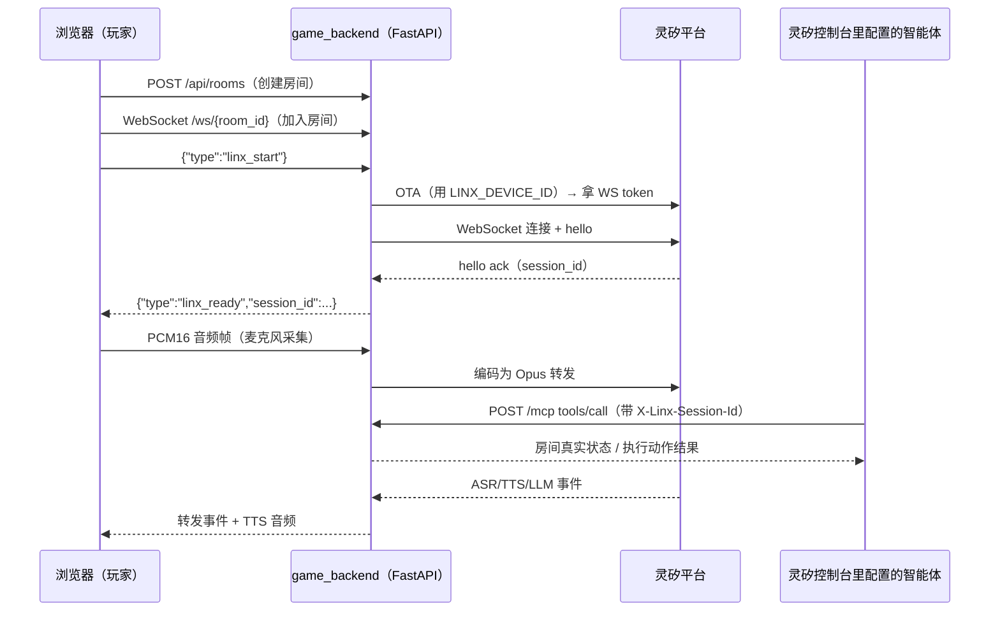

# 游戏后端：别让它听见

《别让它听见》的浏览器 + 游戏后端 + 灵矽语音/MCP 接入的技术文档。目标是让任何人拉下代码后，
不需要额外口头交接，就能完成编译、部署、开发、测试和端到端演示验证。

玩法规格见 [docs/game-design.md](../../docs/game-design.md)；这里讲工程实现。当前已有可玩的单人
“静默协议”挑战、持续 ASR 结算和事件驱动场景。产品主线是双人语音密室；双人私有信息频道、监听者利用对话
制造反转已在“分离频道”序章中接入：现场员获得随机符号与脉冲映射，监听员获得目标符号；监听员授权后，现场员才能校准。
首阶段说过的特征会被监听者学成禁语，后续需要使用替代表达。私有线索、邀请链接和结局已接入页面。
双人默认倒计时为 12 分钟；这是时限配置，并不代表已验证真实玩家会游玩 10–15 分钟。
断线后计时暂停，使用原代号重连恢复角色、当前线索和计时；尚未实现防冒用身份认证。
单人和海妖模式暂作为引擎实验能力维护。

## 架构总览



浏览器不持有灵矽 token；后端用环境变量 `LINX_DEVICE_ID`（一个已预注册的灵矽设备 MAC）做 OTA
换取每次会话的短期 token。灵矽智能体通过 MCP 协议回调后端的 `/mcp` 端点查询/修改房间状态，
后端用 `X-Linx-Session-Id` 请求头把 MCP 调用关联回发起它的浏览器玩家，没有映射的调用会被拒绝，
不能操纵任意房间（详见下方"MCP 安全模型"）。

双人同时监听必须配置 `LINX_DEVICE_IDS`（逗号分隔的不同预注册 MAC）。后端为每个活跃语音会话
独占分配设备，关闭时归还；设备池耗尽会明确报错，避免平台用新连接踢掉同 MAC 的旧连接。
未配置设备池时仍支持 `LINX_DEVICE_ID` 单会话，不能并发复用它。池目前仅在单服务进程内协调。

## 目录结构

```text
src/game_backend/
├── server.py          # HTTP/WebSocket 房间服务 + MCP 端点 + 灵矽会话编排
├── game_engine.py     # 引擎契约、单人/双人场景实现和语音意图规则
├── linx_client.py     # OTA、灵矽 WebSocket 认证与协议客户端
├── audio_codec.py      # PCM16 / 裸 Opus / WAV 编解码
├── static/             # 浏览器页面（index.html）和 AudioWorklet（pcm-worklet.js）
├── requirements.txt
└── tools/               # 端到端测试脚本，见下方"测试"
deploy/
├── Dockerfile
├── compose.yaml
├── nginx-game-backend.conf   # 给浏览器页面做 HTTPS 终止
└── .env.example
.github/workflows/ci-cd.yml   # push 即构建；push 到 main 即自动部署
```

### 场景与模式扩展

`Room` 只保存 `mode` 并通过 `create_game(mode)` 取得满足 `GameEngine` 契约的场景实例；它不依赖任何
具体物件或谜题。新模式需要实现 `public_state`、`start`、`tick`、`process_utterance` 四个方法，并在
`create_game` 注册。场景把语音文本结算为结构化事件，房间服务负责广播，浏览器根据事件/状态渲染动画。

- `solo`：默认模式，`SoloChallengeState` 实现“静默协议”三阶段语音关卡。
- `duo`：`DuoChapterState` 实现“分离频道”三阶段序章；两名玩家分别持有映射和目标，须由不同角色授权和校准。

## 本地开发

```bash
python3 -m pip install -r src/game_backend/requirements.txt
LINX_DEVICE_ID=<已预注册的灵矽设备 MAC> \
  python3 -m uvicorn game_backend.server:app --app-dir src --reload --port 8080
```

打开 <http://127.0.0.1:8080/>，页面可以创建房间、启动首版状态机，并通过 WebSocket 同步状态。本地跑
没有 HTTPS，`navigator.mediaDevices.getUserMedia` 在非安全上下文下不可用，所以本地主要用来跑通房间逻辑；
要测真实麦克风/灵矽持续监听，走下面的部署流程。

`LINX_DEVICE_ID` 从哪来：参考 [docs/tech-research.md](../../docs/tech-research.md) 里"免硬件
开发方案"一节，在灵矽控制台手动预注册一个虚构 MAC 绑定到一个智能体，这个 MAC 就是
`LINX_DEVICE_ID`。

## 部署

### 自动部署（正常流程）

`main` 分支上的每个 push，`.github/workflows/ci-cd.yml` 都会在自托管 runner（当前是
`jfcs1026`）上自动构建镜像并跑 `docker-compose -f deploy/compose.yaml up -d --build`，然后拿
`http://127.0.0.1:18080/` 做健康检查，最多等 30 秒。按仓库"基于 PR 提交每次变更"的规则，正常
流程是：开分支改代码 → push → 开 PR → 合并到 main → 自动部署，不要直接 push main。

任意分支的 push 都会跑 `validate` job（Python 语法检查 + 构建镜像，不部署），用来在合并前
提前发现构建问题。

查部署状态：

```bash
gh run list --repo whaili/Hackathon-2026 --limit 5
ssh jfcs1026 'docker ps --filter name=dont-let-it-hear-game'
ssh jfcs1026 'docker logs --tail 200 dont-let-it-hear-game'
ssh jfcs1026 'docker logs -f dont-let-it-hear-game'   # 跟着看，调试时常用
```

> 如果本地/CI 环境里 `GITHUB_TOKEN` 环境变量指向一个失效 token，`gh`/`git push` 会报认证错误，
> 用 `env -u GITHUB_TOKEN -u GH_TOKEN gh ...` / `env -u GITHUB_TOKEN -u GH_TOKEN git push` 绕开它，
> 它会优先于你本地 `gh auth login` 存的凭证。

### 手动 / 本地容器部署

```bash
cp deploy/.env.example deploy/.env
# 在 deploy/.env 里填 LINX_DEVICE_ID
docker compose -f deploy/compose.yaml up -d --build
```

部署目标是 `http://127.0.0.1:18080`（容器内部端口 8080，映射到宿主机 18080）。给真人玩家用的
HTTPS 浏览器入口由 Nginx 终止（`deploy/nginx-game-backend.conf`，监听 18081，反代到
127.0.0.1:18080），证书是自签名的，浏览器首次访问需要手动点"继续访问"信任一次。

### MCP 公网暴露（灵矽云端需要能回调到这个地址）

灵矽云端必须能访问到 MCP 端点，局域网地址和自签名证书不能用。当前用 Cloudflare Quick Tunnel
临时解决：

```bash
cloudflared tunnel --url http://127.0.0.1:18080 --no-autoupdate
```

**这个 URL 每次重启 cloudflared 都会变**，不适合正式演示。生成新 URL 后要去灵矽控制台重新配置
一遍（见下方"灵矽控制台配置"），否则灵矽会继续调用一个已经失效的旧地址。正式演示前应换成
Cloudflare Named Tunnel + 自己的稳定域名，或者把后端部署到一个本来就有受信任 HTTPS 的云环境。

## 灵矽控制台配置

MCP 服务的创建、发布、绑定到智能体，完整操作路径：

1. 控制台 → MCP → 自定义 MCP → 新建服务，传输协议选 `Streamable HTTP`，URL 填当前公网
   MCP 地址（Cloudflare Tunnel 域名 + `/mcp`）
2. 发布服务，然后在"已开通 MCP"里开通它
3. 智能体管理 → 选中目标智能体 → 配置角色 → 技能与扩展 → MCP编辑 → 把这个服务勾选进"已选
   MCP"→ 保存
4. **关键一步，容易漏**：光绑定 MCP 服务不够，模型不会仅因为工具已绑定就调用它。必须在同一个
   "配置角色"页面的"角色介绍"（Prompt）里**明确写出**什么时候调用哪个工具。绑定了服务但没写
   Prompt 指令，模型会用默认人设跟玩家瞎聊，完全不会碰这个工具——这是本项目踩过的第一个坑，
   详见下方"已知问题与修复记录"。

当前（2026-10-24）线上智能体的实际配置状态，供核对或在配置丢失/被覆盖时参考恢复：

- 智能体名称：`Hackathon语音游戏测试`
- MCP 服务：`别让它听见 MCP（测试）`，已勾选进"已选 MCP"
- 技能与扩展 → 默认插件：**只保留"退出意图处理"**，天气/新闻/时间获取/黄历获取均已取消勾选
  （原因见下方"已知问题与修复记录"，这不是随手关的，是测出来必须关）
- 角色介绍（Prompt）要点：明确要求"游戏状态"/"当前警报"/"房间情况"类问题调用
  `game.get_state`。单轮模式下具体游戏动作调用 `game.apply_action`；**持续监听模式中不要为每条
  玩家口令再调用 `game.apply_action`**，后端已在收到 ASR 时确定性结算，以免重复执行。工具结果是
  唯一事实来源，并要求"工具调用没拿到结果时先自己重试一次，而不是直接道歉放弃"
- 保存配置后界面会提示"需要重启设备，新的配置才会生效"——但本项目的"设备"都是每次
  `linx_start` 新建的虚拟会话，没有常驻进程，不需要手动重启什么，下一次新会话自然会用上新配置

Cloudflare Tunnel URL 变更后，要回到第 1 步把 MCP 服务的 URL 改掉、保存，并重新走一遍第 3 步
把 MCP 绑定和 Prompt 再保存一次（界面上两处都有独立的"保存"，改了 URL 只保存 MCP 那一层不够）。

## MCP 服务契约

实现的路由：`GET /mcp`（健康检查/部署验证用）、`POST /mcp`、`POST /mcp/message`（两个 POST 路径
等价，是为了兼容不同版本的 MCP 客户端）。

支持的 MCP 方法：`initialize`、`notifications/initialized`、`tools/list`、`tools/call`。

当前工具（`server.py` 里 `mcp_message` 的实现）：

- `game.get_state`：读取当前灵矽会话绑定房间的完整状态，无参数。状态包含阶段、倒计时、动态禁语、
  当前警报、物品位置/持有者、下一目标、错误次数和最近后果。
- `game.apply_action`：单轮模式接受任意字符串 `action`，按与 ASR 相同的确定性规则解析移动、拾取、
  放入逃生舱。持续监听模式中，ASR 已先执行该规则；此工具只返回权威状态以防同一句重复执行。

## 游戏引擎与模式

所有 `say`、`action`、持续模式的 `stt` 与单轮 MCP 动作都进入房间当前引擎的同一解析器。警报到 5 级或
倒计时结束均失败。

### 单人挑战：静默协议

`POST /api/rooms` 不带参数或传入 `{"mode":"solo"}` 会创建默认单人房。`game_start` 启动 90 秒挑战：

1. 说“探索能源区”，再用“选择最尖锐的脉冲”等安全表述识别能源。
2. 说“检查控制台”，再说“校准稳定重复的频率”。
3. 说“解除安全锁扣”，再说“启动主推进”。

每阶段有两条公开的禁忌概念；触发其可识别表达会加警报并阻断该句动作。玩家可说“请求提示”，共两次，
每次获得线索但增加一级警报。无法识别的表达只请求澄清，不会随机推进。完整规格和可接受表达见
[docs/game-design.md](../../docs/game-design.md)。

### 双人章节：分离频道

`POST /api/rooms` 传入 `{"mode":"duo"}` 创建双人章节。第一名玩家为现场员，第二名为监听员。
两人连接后才能启动；私有简报分别提供随机符号映射和目标符号。监听员说“授权”加目标符号，现场员说“校准”加对应特征。
第一轮的特征描述被监听者学成禁语；第二轮监听员说“识别伪装，安全符号是”加符号（也支持“识破”），现场员用替代表达校准。
最后双方交换信息，各自说“确认撤离”或“保留档案”；两人一致才结算，不一致可继续协商。两种选择产生不同结局。
旧的物品拾取规则仍有独立引擎单元测试，但双人入口已使用分离频道规则。

### MCP 安全模型

后端只在浏览器完成灵矽 `hello` 握手后，才会把这次 MCP 请求头里的 `X-Linx-Session-Id` 映射到
`(room_id, player_id)`。没有这个映射的调用（session id 不存在、或从来没有对应的浏览器会话）会
被拒绝：

```json
{"code": -32001, "message": "No active browser game session for this Lingxi session"}
```

意味着没人能拿一个瞎编的 session id 操纵任意房间——这一点有独立测试验证，见下方"直接测 MCP
服务端"。

## 使用说明（怎么玩一局）

1. 浏览器打开部署的 HTTPS 地址（如 `https://10.210.34.33:18081/`）
2. 首次访问会跳出自签名证书警告，点"高级"→"继续前往"信任一次
3. 大厅默认选择双人章节；创建后复制邀请链接给同伴，两人以不同代号加入后启动。单人调试可切换“单人挑战”继续以下步骤
4. 双人都连接后启动，双方阅读各自私有线索；单人模式则显示“静默协议”关卡
5. 点“启动持续监听”，允许浏览器的麦克风权限请求
6. 双人根据私有线索授权、校准、识破假命令并共同选择结局；单人按“探索能源区”等提示推进
7. 观察监听波、警报和进度；双人断线会暂停，用原代号重连。两次“请求提示”仅属于单人模式

> 注意：如果你和部署主机不在同一个内网/VPN，可能连不上私网 IP，需要先确认网络路由，或者让
> 部署的人给一个能从外网访问的地址。

## 测试

先执行确定性单元和 WebSocket 回归，不消耗灵矽额度：

```bash
PYTHONPATH=src python3 -m unittest discover -s src/game_backend/tests -v
```

其中包含单人模式完整通关、禁忌阻断、求助消耗、模式建房与 WebSocket 状态机测试。

### 1. 快速健康检查（不消耗灵矽额度）

```bash
curl -fsS http://127.0.0.1:18080/            # 后端本身
curl -fsS https://<公网 MCP 地址>/mcp         # MCP 健康检查，预期返回里有 dont-let-it-hear-mcp
```

验证 MCP 协议本身（`initialize`/`tools/list`），同样不消耗灵矽额度，因为完全不经过灵矽：

```bash
curl -s -X POST https://<公网 MCP 地址>/mcp \
  -H 'Content-Type: application/json' -H 'Accept: application/json, text/event-stream' \
  -d '{"jsonrpc":"2.0","id":1,"method":"initialize","params":{"protocolVersion":"2025-03-26","capabilities":{},"clientInfo":{"name":"check","version":"1"}}}'

curl -s -X POST https://<公网 MCP 地址>/mcp \
  -H 'Content-Type: application/json' -H 'Accept: application/json, text/event-stream' \
  -d '{"jsonrpc":"2.0","id":2,"method":"tools/list","params":{}}'
```

### 2. 人工浏览器端到端测试

按上面"使用说明"的步骤走一遍，适合最终演示前的真实体验确认。缺点：需要真实麦克风、需要手动
点掉证书警告、不好写进 CI、不好量化统计成功率。

### 3. 脚本化端到端测试（不需要真实浏览器/麦克风）

`src/game_backend/tools/` 下有验证脚本，按浏览器实际走的协议直接跟后端 WebSocket 打交道，用
[edge-tts](https://github.com/rany2/edge-tts) 合成语音代替真实麦克风输入（后端不区分真麦克风
和回放的 PCM 流，所以这是同一条代码路径）：

```bash
cd src/game_backend/tools
pip install --user edge-tts
bash gen_audio.sh                       # 生成测试语音
python3 e2e_test.py audio/query_state.pcm   # 单次端到端：创建房间→建立灵矽会话→识别→播报
python3 e2e_test.py audio/solo_explore.pcm --continuous --mode solo # 单人探索 ASR→状态机
MCP_URL="https://<公网 MCP 地址>/mcp" python3 session_mcp_test.py   # 绕开灵矽，直接测后端 MCP 实现
bash batch_test.sh 20                   # 批量测可靠性，见下一节
```

完整用法说明见 [tools/README.md](tools/README.md)。

### 4. 批量可靠性测试

灵矽那边把工具调用交给大模型决定，存在"看到了工具定义但这一轮没有真的调用"的间歇性失败
（下面"已知问题"有完整分析）。`batch_test.sh` 跑 N 次交替测试，通过 SSH 读部署主机上
`POST /mcp` 的日志行数前后差值客观判定每次是不是真的触发了 `tools/call`（4 次日志 = 成功，
3 次 = 卡在 `tools/list` 没往下走），不依赖主观读 AI 回复文本：

```bash
bash batch_test.sh 20
```

结果写到 `tools/batch_results.tsv`。改了 Prompt 或智能体配置之后，应该重新跑一轮，不要假设
之前测过的结论还成立。

### 5. 双人文字端到端回归（不需要真人、浏览器或灵矽额度）

`tools/multiplayer_text_e2e.py` 会创建真实双人房间，建立两条独立 WebSocket
连接，并让 Alice 和 Bob 交替发送文字语音转写。它会验证两个客户端都观察到每一次状态转换、
收到的公共状态始终一致，私有线索各不相同；根据随机线索完成授权校准、识破假命令及共同抉择，最终收到 `game_won`。
该脚本使用确定性线索解析器，还没有接入自主 AI 玩家或自动 AI 评审；文字测试不经过灵矽 ASR。

```bash
GAME_BASE_URL=http://127.0.0.1:8080 \
  python3 src/game_backend/tools/multiplayer_text_e2e.py --json
```

也可以直接验证部署环境（自签名证书会自动跳过校验）：

```bash
GAME_BASE_URL=https://10.210.34.33:18081 \
  python3 src/game_backend/tools/multiplayer_text_e2e.py --json
```

脚本输出的 JSON 可交给 AI 评审器评价协作质量、信息差和异常；程序断言负责判断状态正确性。

### 6. 真实浏览器、虚拟麦克风与灵矽全链路

`tools/browser_voice_e2e.py` 从真实页面入口完成双人对局：文字合成 WAV → Chromium 虚拟麦克风 →
页面 AudioWorklet → 后端 Opus → 灵矽 ASR → 状态机 → 双方页面结局。不会用文字消息替代音频。

安装依赖、设备池要求、执行命令、截图和 JSON 报告说明见 [测试工具手册](tools/README.md#双人真实浏览器语音全链路测试)。
该测试需两个不同的预注册设备，消耗外部服务额度；目前每句切换音频会重连该玩家，不覆盖自然抢话与回声。

## 已知问题与修复记录

### 智能体 Prompt 必须显式写工具调用指令（已修复）

绑定 MCP 服务本身不会让模型自动调用工具，必须在 Prompt 里明确写触发条件（见上方"灵矽控制台
配置"第 4 步）。本项目最初绑定了服务但 Prompt 还是创建智能体时的默认人设，导致完全不触发
`game.get_state`/`game.apply_action`，排查后已修复并写死在 Prompt 里。

### 间歇性"看到工具但没调用"失败（主因已修复，有残余）

用 `batch_test.sh` 跑了 30 次交替测试定位这个问题：

| 阶段 | 样本 | 成功率 | 失败特征 |
|---|---:|---:|---|
| 技能与扩展里默认插件全开 | 10 | 80%（8/10） | 两次失败都是模型自己说"误调了黄历获取"——是**选错了工具**，不是看不见工具 |
| 关掉天气/新闻/时间获取/黄历获取后 | 20 | 95%（19/20） | 1 次失败换了个特征："系统没有响应"，没有误调迹象 |
| 再给 Prompt 加一条"没拿到结果就自己重试一次"的指令后 | 10 | 100%（10/10） | 无 |

**结论**：主要失败原因是这几个无关默认插件跟"查询...状态"这类措辞抢路由，关掉它们解决了
80% 的问题。剩下的失败是灵矽平台内部工具分发的黑盒行为，我们这边改不了，所以把兜底放在能控制
的地方——Prompt 里加自我重试指令。30 次里最后 n=10 这组样本还比较小，"100%"不代表彻底零失败，
只能说没有变差；如果以后发现 AI 反复说"信号不太稳定，再说一遍试试"（这是重试指令失败后的兜底
话术），说明残余失败率比目前测到的更高，建议重新跑一轮更大样本的 `batch_test.sh`。

### 其他已知限制

- Cloudflare Quick Tunnel 是临时的，进程重启后域名会变，不适合正式演示用的稳定地址
- 房间状态和灵矽会话映射都在进程内存里，多副本部署需要换成 Redis 之类的共享存储
- 灵矽会话正常结束时，映射不一定立刻清理；WebSocket 断线清理是立刻的。长期运行前需要把这个
  生命周期收紧
- 浏览器页面走 Nginx 做 HTTPS 终止；MCP 流量是 Cloudflare Tunnel 直接打到后端，没有经过 Nginx
- 自动化已覆盖双浏览器持续会话、双路并发识别及协议层断线恢复；真人设备、声学回声与趣味性尚未验证
